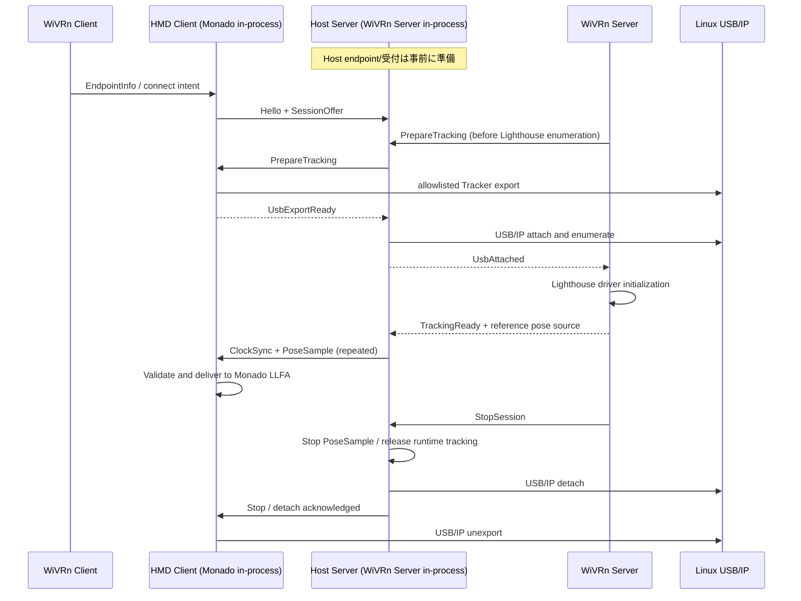

# LLFA-Link-Light-Bridge — 実装指示書 v0.3.1

- **対象**: LLFA-Link-Project / Orange Pi 5 (Linux arm64) ↔ Host PC (Linux x86_64 等)
- **主要言語**: Rust stable
- **主要成果物**: Monado プロセス内 `HMD Client` Rust ライブラリ、WiVRn Server プロセス内 `Host Server` Rust ライブラリ、FFI アダプタ、テスト、実機検証手順
- **優先ターゲット**: arpara HMD + 独立 USB 接続の arpara Lighthouse Tracker
- **状態**: 要求仕様 + 実装指示。未確認の upstream/実機差分は必ず確認すること
- **作成日**: 2026-10-11
- **基準**: 以前の `LLFA-Link-Light-Bridge-INSTRUCTIONS-v0.2.md` を本書で更新・置換する。矛盾する記述では本書を優先する

---

## 0. 実装エージェントへの最優先指示

このファイルは単なる設計メモではなく、**段階的に動くコードを作成するための作業指示書**である。

1. **まず既存リポジトリと WiVRn Server に適用済みの integration 差分を調査する**。ソースのない API 名、既存ブランチの構造、未確認の接続イベントを実在するものとして扱わない。
2. **2つの Rust ライブラリが主動作核**。Orange Pi 側は Monado プロセス内、Host 側は WiVRn Server プロセス内に組み込む。従来案の常駐 `bridge-agent` / `bridge-hostd` を主要動作核として新設しない。
3. **FFI、セッション状態機械、通信プロトコル、USB/IP バックエンドを分離**し、mock を使って USB 実機なしでもテスト可能にする。
4. **最初の縦断実装 (vertical slice)** は「WiVRn Client から接続先通知 → Bridge 接続・準備 → mock USB attach → mock Lighthouse pose を Host→HMD→Monado Adapter へ伝達 → stop/cleanup」。これを完了してから実 USB/IP に切り替える。
5. 実機接続では arpara **Tracker だけ**を USB/IP export する。**arpara HMD 制御/IMU (`2c30:1050`) を bind しない**。
6. USB/IP は当面 Linux 標準機能を利用する。独自 USB/IP protocol、カーネルドライバ、部分 interface USB 転送を先に実装しない。
7. **BSB 専用コードは MVP の対象外**。ただし IMU 入力、USB 所有権、Direct/usbmon キャプチャの拡張点は型/API と状態遷移で確保する。未検証の BSB 動作を「対応済み」と記さない。
8. 一般ユーザー権限の Monado / WiVRn プロセスから任意の root コマンドを実行しない。USB 操作には対象機器を限定した特権境界を用意する。
9. 使用可能なソース・ハードウェアが不足しても、mock で動くコア実装、テスト、次の作業に必要な具体的な不足情報を成果物として残す。理由なく設計だけで終わらない。
10. 実装途中で設計変更が必要になった場合は本書との差分を `docs/DECISIONS.md` に記録する。ユーザーの要求を暗黙に変更しない。

**要求レベル**: `[必須]` は仕様上固定、`[提案]` は最初の実装例、`[要検証]` は実機・ソースに基づく確認が必要。

## 1. 目的と非目的

### 1.1 目的 [必須]

LLFA-Link-Light-Bridge は、Orange Pi に接続された Lighthouse Tracker 相当の USB デバイスを Host PC に USB/IP で認識させ、Host PC 側 VR ランタイムが取得した Lighthouse 由来の **6DoF 参照姿勢と計測時刻情報**を Orange Pi に返送し、Monado LLFA がローカル IMU と時間整合・融合できるようにする。

WiVRn 自身に USB/IP やデバイス固有 IMU の実装を持ち込まず、将来的な ALVR / ALXR / SteamVR ドライバとの統合を可能にする。

### 1.2 非目的 (MVP)

- Monado の融合アルゴリズムやリプロジェクションを Bridge 側へ移植しない。
- BSB の USB interface 分離、仮想 USB、UHID、usbmon、libsurvive の移植・完成を MVP の成功条件にしない。
- USB/IP 全 URB を Rust で再実装しない。
- WiVRn の標準動画・映像転送プロトコルを変更しない。
- Windows USB/IP の互換性を保証しない。
- トラッカー姿勢が直ちに HMD 姿勢と同じであると仮定しない。
- `usbipd` 等の OS 管理コンポーネントまで Monado と同一プロセスに閉じ込めることを要件としない。**IMU/姿勢の低遅延経路を同一プロセスに置くこと**が主要要件である。

## 2. 確定した全体アーキテクチャ

```text
Orange Pi 5 / Linux (arm64)                      Host PC / Linux
┌────────────────────────────────────┐          ┌───────────────────────────────────────┐
│ WiVRn Client / future ALVR Client  │          │ WiVRn Server / future SteamVR driver │
│    └─ 接続先・セッション通知 (IPC) ─┐│          │      │ lifecycle + pose (FFI)        │
│                                   ││          │      ▼                               │
│ Monado process                    ││          │ ┌─────────────────────────────────┐ │
│ ┌────────────────────────────────┐││          │ │ Host Server (Rust library)      │ │
│ │ LLFA HMD Driver                │││          │ │  - control / lifecycle          │ │
│ │   ↑ external pose + clock     │││          │ │  - USB/IP import management     │ │
│ │   ↑ IMU (HMD-dependent)        │││          │ │  - timestamped pose publisher  │ │
│ │ ┌────────────────────────────┐ │││  Bridge  │ └─────────────────────────────────┘ │
│ │ │ HMD Client (Rust library)  │◀┼┼─────────▶│                 │                     │
│ │ │ - control / lifecycle      │ ││          │ USB/IP import: vhci_hcd             │
│ │ │ - USB/IP export management │ ││  USB/IP  │                 │                     │
│ │ │ - external pose receiver   │ ││◀────────▶│    Lighthouse tracking driver         │
│ │ │ - optional IMU provider    │ ││          │         → tracked pose              │
│ │ └────────────────────────────┘ │││          └───────────────────────────────────────┘
│ └────────────────────────────────┘││
│  local arpara IMU path is separate ││
└────────────────────────────────────┘│
                 │                     │
       Lighthouse Tracker USB         │
        usbip_host + usbipd           │
                 └─────────────────────┘
```

**命名注意**: 本書の `HMD Client` は USB/IP 側では **export/server**、本書の `Host Server` は USB/IP 側では **import/client**。用語を混同しない。

### 2.1 HMD Client — Rust library [必須]

- Orange Pi の **Monado LLFA HMD Driver と同一プロセス**で動作する。
- HMD Driver が生成した Bridge handle を HMD Driver 破棄まで生存させる。WiVRn 接続/切断ごとにハンドル自体を作り直さない。
- WiVRn Client とローカル IPC 等の薄い adapter でやり取りし、接続先 Host Endpoint、識別子、セッション開始/終了を受ける。
- Host Server との独立した Bridge 制御通信を確立し、USB 公開対象の選択・セッション・時刻同期・外部姿勢受信を行う。
- Linux USB/IP を利用し、許可済み Tracker Device を Host へ export する。USB/IP の実転送はカーネル機能に委譲する。
- Host が返送する Lighthouse 参照姿勢を Monado LLFA に同一プロセス内で受け渡す。受信時刻だけでなく **測定時刻、時計ドメイン、同期不確実性、追跡原点**も伝える。
- Monado の通常 Lighthouse Tracking Driver に物理 Tracker を掴ませない。arpara の専用 IMU は既存の独立経路で使用可能なままにする。
- 将来 BSB では HMD Client 内に `ImuProvider` を追加し、`DirectUsb` ↔ `UsbMon` の切り替えを扱える構造にする。

### 2.2 Host Server — Rust library [必須]

- Host PC の **WiVRn Server プロセス内**にリンクまたはロードする。
- WiVRn Server の通常のライフタイム中は Bridge handle を保持し、VR Tracking Session の開始・終了だけを内部の state machine に反映する。
- Lighthouse デバイス初期化の前に USB/IP attach と OS 列挙を完了し、WiVRn がデバイスを検出できる順序を保証する。
- 接続済み HMD Client から公開された Tracker を Linux `vhci_hcd` に import し、Host PC の既存 Lighthouse driver に認識させる。
- WiVRn の追跡バックエンド/対応 `xrt_device` から HMD に紐づく Lighthouse 参照姿勢を取得し、時刻を付けて HMD Client へ配信する。
- WiVRn Client が Host Server のアドレス等を HMD Client に通知できるよう、接続先提示に必要な情報を runtime adapter に渡す。
- 追跡デバイスの USB ハンドルを Bridge 自身で開かない。**Lighthouse tracking の本体所有者は Host runtime/driver**とする。

### 2.3 組み込み境界 [必須]

- HMD Client ↔ Monado LLFA: C ABI / FFI。可能なら直接 `xrt_imu_sink` / `xrt_pose_sink` または LLFA 専用 adapter を使用。ただし適切な Sink と寿命は実ソースで確認。
- WiVRn Client ↔ HMD Client: 小規模なローカル IPC (UDS を初期案)。接続先・接続/切断状態のみ。**高頻度 IMU/pose には使わない**。
- Host Server ↔ WiVRn Server: C ABI / FFI。Prepare、USB ready、tracking ready、publish pose、stop を明示。
- Host ↔ HMD: プロトコル/時刻同期/姿勢ストリームは Bridge 固有であり WiVRn wire protocol を変更しない。
- SteamVR / ALVR / ALXR: 将来の runtime adapter が同じ ABI か共通 Rust API を使用する。既存コードを参照するまでは具体的な他ランタイムフック名を固定しない。

## 3. ライフタイムとスレッド

### 3.1 インスタンス寿命 [必須]

```text
Monado HMD Driver created ── HMD Client create ─────────────────────── destroy
                                  │
                                  ├─ Session A: connect / export / pose / stop
                                  ├─ Session B: connect / export / pose / stop
                                  └─ (local HMD IMU remains available)

WiVRn Server integration loaded ── Host Server create ──────────────── destroy
                                       │
                                       ├─ Session A: import / tracking / stop
                                       └─ Session B: import / tracking / stop
```

`destroy()` は shutdown signal → 資源解放/worker 停止 → join → callback 無効化 → Rust handle 解放を行う。自分自身の worker から self-join しない。`destroy` が長時間ブロックしない設計と期限付き中断を設ける。

### 3.2 推奨スレッド [提案]

- **Control worker**: ネットワーク制御、セッションイベント、keepalive。
- **Pose I/O worker**: Host の外部姿勢送信 / HMD の受信、シーケンス・鮮度検査。制御路での長時間待機に引きずられない。
- **USB manager worker**: bind/attach の準備・結果待ち・解放。**USB 操作で Monado の姿勢取得スレッドをブロックしない**。
- **Optional IMU capture worker**: BSB 将来機能。arpara の IMU を Bridge に重複実装する必要はない。

実際の worker 数は性能計測で調整してよい。専用 OS thread、単一 Tokio runtime + 非同期 task などの選択は実装者に委ねるが、**高頻度姿勢配信と USB 連携の低速制御を同一のブロッキングループに入れない**。bounded channel、キャンセル可能な待機、終了時の join を必須にする。リアルタイム優先度は測定前に上げない。

### 3.3 FFI の安全性 [必須]

- `#[repr(C)]` 構造体、固定幅整数、明示的な所有権と `size`/`abi_version` を使用。Rust `String`、trait object、enum の内部レイアウトを直接公開しない。
- 不透明 handle と `create` / `request_*` / `destroy` を用い、ABI 呼び出しで panic/unwind を C/C++ に伝播させない。
- callback の呼び出しスレッド、再入可能性、同期/非同期性、データの借用期間を明記する。
- C/C++ 側が破棄した callback userdata へ Rust worker がアクセスしないよう shutdown barrier を用意。
- 同一 callback を並列呼び出ししない前提が必要なら、それを契約に含めて内部で直列化する。
- FFI callback 内から blocking な `usbip attach` を呼ばない。
- Header 生成と C 呼び出しの smoke test を CI に含める (`cbindgen` 等は候補)。

## 4. USB/IP の責任境界

### 4.1 初期実装 [必須]

- Orange Pi: `usbip_host` + `usbipd` を使って **Tracker USB Device を丸ごと export**。
- Host PC: `vhci_hcd` と `usbip attach/detach` を使って import。
- Rust ライブラリは USB/IP の制御・監視・セッションとの紐付けを担当。
- `usbipd` 等が別プロセスでも許容する。**同一プロセス要件は Bridge 内の IMU/姿勢低遅延経路に対するもの**。
- カーネルモジュールの存在/権限は実機で検査し、不足時には具体的な診断エラーを返す。

### 4.2 デバイス選択 [必須]

- arpara HMD と arpara Tracker は **別 USB 接続**（ユーザー提供条件）。**Tracker だけ**を export し、HMD に接続された `2c30:1050` の制御/IMU は Orange Pi のローカル利用に残す。
- export は VID/PID だけの盲目的探索を避け、USB busid、sysfs path、serial、port topology、許可リストを照合する。
- busid は再接続で変わるため永続デバイス ID と同一視しない。
- 許可されない/曖昧なデバイス選択時は失敗させる。
- 既に Host に attach 済みのデバイスへの重複 export/attach を防ぐ。
- Host の USB/IP port は実測で得た値を保存し、**自分の session が作成した port のみ**detach する。

### 4.3 Backend の境界 [必須]

設計上 `UsbInventory` → `ExportPlanner` → `UsbTransferBackend` を分ける。

```rust
// Conceptual API: exact Rust signatures are implementation choices.
enum ExportTarget {
    WholeDevice(UsbDeviceIdentity),
    Interfaces { device: UsbDeviceIdentity, numbers: Vec<u8> },
}

enum TransferBackendKind {
    KernelUsbIp,
    // Future research only:
    HidReportProxy,
    VirtualUsbDevice,
}
```

`KernelUsbIp` が対応するのは **WholeDevice のみ**。`Interfaces` が指定された場合、勝手に WholeDevice に拡大してはならず `UnsupportedExportGranularity` を返す。USB Device、USB Interface、内部 Hub 下の Device を混同しない。

### 4.4 特権操作 [必須]

Monado / WiVRn Server の in-process Rust ライブラリが root になることを要求しない。

- 特権が必要な操作は **固定操作・固定引数スキーマ・厳格な allowlist** を持つ helper またはサービスに委譲する。
- 任意文字列を shell に渡さない。CLI を起動する場合は引数配列で実行、timeout、exit status、stderr を検査。
- helper の lifetime は Bridge Core と別でもよい。直接 Pose/IMU stream を helper に経由させない。
- OS 再起動やプロセスクラッシュ後に残った USB/IP bind/attach の検出・回収手順を設計する。
- 自動で他プロセス所有の USB/IP ポートを一括 detach しない。

## 5. ネットワーク、セッション、同期

### 5.1 ローカル通知と Host endpoint [必須]

- WiVRn Client が Host PC のアドレスを知る時点で、HMD Client へ通知する。
- WiVRn Server 側は、Bridge Host の接続先 port 等を WiVRn Client に提示できるようにする。
- 複数 NIC、IPv4/IPv6、port、Host 識別子、セッション相関 ID を扱える `EndpointInfo` を設計する。
- WiVRn 接続確立、Bridge 接続開始、Lighthouse driver 初期化を **別イベント**として扱う。
- WiVRn のどのパケット/IPC/状態で接続先情報を得られるかは実ソースから特定する。確定していない実装箇所は調査メモに残す。

### 5.2 最小メッセージセット [提案]

| 名前 | 主な方向 | 意味 |
|---|---|---|
| `Hello` | 双方向 | プロトコル互換性・接続情報の確認 |
| `SessionOffer` | 双方向 | session ID、endpoint、capabilities と利用 HMD/Tracker の対応づけ |
| `PrepareTracking` | Host → HMD | USB export の準備要求 |
| `UsbDeviceOffer` | HMD → Host | 選択済み Tracker の identity / busid / backend 情報 |
| `UsbExportReady` | HMD → Host | export 側準備完了 |
| `UsbAttached` | Host → HMD | Host OS 側 attach + 列挙完了 |
| `TrackingReady` | Host → HMD | Lighthouse driver 初期化完了。`UsbAttached` と分離 |
| `ClockSync` | 双方向 | 時刻系の推定と不確実性の更新 |
| `PoseSample` | Host → HMD | 時刻付き Lighthouse pose と quality flags |
| `StopSession` / `Stopped` | 双方向 | 追跡停止・USB 解放・終了確認 |
| `Heartbeat` / `Error` | 双方向 | 障害とリース・監視 |

- すべての状態変更要求は `session_id` と sequence/operation ID で重複処理可能にする。
- 名前は案であり、既存の integration 差分がある場合は衝突しない API を選ぶ。
- 制御・Pose チャネルに最大 frame size、未知 field/version の扱い、タイムアウト、backpressure、メッセージ制限を定義する。

### 5.3 時刻と外部姿勢 [必須]

```text
ExternalPose {
  protocol_version,
  session_id, sequence,
  tracked_device_id,
  tracking_origin_id, frame_id,
  source_clock_id,
  sample_timestamp_ns,       // 計測時刻。取得できない場合は semantics を明示
  timestamp_semantics,       // measured / estimated / query-time 等
  clock_uncertainty_ns,
  position_m[3], orientation_xyzw[4],
  linear_velocity_mps[3]?, angular_velocity_radps[3]?,
  position_valid, orientation_valid, tracked,
}
```

- Lighthouse pose は **どの tracked device の pose なのか**を明確にする。
- Lighthouse トラッカーと HMD の剛体外部較正 `T_HMD_Tracker` (命名・向きは明記) を必要に応じて適用する。**両者が一致すると決めつけない**。較正未設定時は有効な head pose に昇格させず診断を出す。
- 元の tracking origin の ID と origin 変換履歴を保持し、reset/再センタリングで座標が不連続になったら処理する。
- Host と Pi の monotonic clock は別物。`ClockSync` により offset、drift、RTT、uncertainty を推定し、Monado の時計系へ変換する。
- WiVRn/Monado の `get_tracked_pose(at_timestamp_ns)` が返すものは問い合わせ時刻の予測 pose であり得る。**実際の観測時刻と混同しない**。取得 API の時刻意味論が不明なら `estimated` / `query-time` として記録し、測定時刻扱いで融合しない。
- 古い、不正、逆行、session の異なる pose、`tracking_lost`、大きな不確実性には有効期限と reject policy を適用する。しきい値は設定可能・テスト可能にする。
- Monado LLFA の姿勢融合は Bridge の外。Bridge は reference pose と metadata を提供し、同一補正の二重適用をしない。

## 6. 初期化順序、再接続、終了

### 6.1 成功時シーケンス [必須]



### 6.2 起動デッドロックの回避 [必須]

- Host Server は Lighthouse driver 列挙前から Bridge の受信・準備を開始できる必要がある。
- HMD Client の接続先通知は Lighthouse 初期化完了を待ってはならない。
- Client 側の endpoint 通知と Host 側の `PrepareTracking` のどちらが先でも、同一 session で合流できる。
- Host は無期限に待たない。準備失敗時の動作は `fail session / fallback tracking / continue without Lighthouse` を明示的に設定する。MVP の既定値は安全側の明示失敗とし、想定外の無言フォールバックを避ける。
- `UsbAttached` は kernel/OS への USB enumeration 完了、`TrackingReady` は Lighthouse runtime 初期化完了として区別する。

### 6.3 状態機械 [提案]

```text
Idle → Connecting → Negotiated → PreparingUsb → UsbAttached
     → TrackingInitializing → Active → Stopping → Idle
                              ↘ Failed → Cleanup → Idle
```

同一 session の重複 prepare/stop、前セッションの遅延 Pose、相手のクラッシュ、USB ケーブル抜去、Wi-Fi 瞬断、USB/IP port 残留をテストする。切断しただけで HMD Client 自身を破棄してはならない。

### 6.4 終了手順 [必須]

1. `StopSession` を発行し新規 Pose 配信を停止。
2. Host runtime が Lighthouse driver の使用を止め、必要な USB ハンドル解放を確認。
3. Host が今回保持した USB/IP port を detach。
4. Orange Pi が今回 export した Tracker を unbind/unexport。
5. 両側が `Stopped` とリソース解放を記録。
6. 両 Rust ライブラリインスタンスは、その親プロセス/driver が生きている間は存続可能。

通常終了はこれを基本とする。異常終了は timeout と所有権記録に基づく限定的 cleanup を行う。

## 7. HMD ごとの IMU ソースと BSB の将来性

### 7.1 arpara MVP [必須]

- arpara HMD の IMU は専用 HMD HID 経路から Monado LLFA に提供する（本書の USB/IP 実装とは別）。
- Orange Pi の Monado が Lighthouse Tracker に直接アクセスしない。Tracker は HMD Client により Host PC 側に公開する。
- arpara HMD の HID `2c30:1050` と arpara Tracker を混同しない。`2c30:1050` に対する export を default deny にする。
- 既存の arpara HID 解析資料は `README.md`, `hid-format.md`, `imu-format.md`, `commands.md` を参照。そこには HMD 自身の 1 kHz IMU/200 Hz 磁気センサと初期化シーケンスが記載されているが、**Tracker の USB identity を意味しない**。

### 7.2 BSB 将来拡張 [必須: 拡張点のみ]

BSB では Lighthouse デバイスから IMU を得る必要がある可能性がある。将来、HMD Client 内に次の `ImuProvider` 抽象を置く。

```rust
// Conceptual, not a stable API.
enum ImuCaptureMode {
    None,          // e.g. arpara: HMD-specific IMU resides elsewhere
    DirectUsb,     // libsurvive owns device locally
    UsbMon,        // observe USB traffic while Host owns via USB/IP
}

struct ImuSample {
    sample_time_ns: i64,
    accel_mps2: [f32; 3],
    gyro_radps: [f32; 3],
    source_id: u64,
    timestamp_quality: u32,
}
```

- BSB 非接続時: 可能なら HMD Client 内の libsurvive Direct USB backend が IMU を取得。
- BSB Host 転送中: USB/IP が対象を所有し、ローカル `usbmon`/libsurvive usbmon backend が受動監視して IMU を取り出す構想。
- **USB/IP と usbmon の同時利用、BSB USB topology、BSB IMU report decode、監視時の sampling/jitter は未検証**。libsurvive の usbmon driver が存在することは BSB での成功の証明ではない。
- Direct→UsbMon→Direct 切り替えでは USB 所有権を state machine で排他的に管理し、IMU stream 断/再開、clock continuity、較正、context 再生成を設計する。無停止切替は要求しない。
- USB/IP が同一 USB Device 全体を奪い HMD の他の必須 Interface も失う場合、標準 USB/IP での BSB 対応は **非対応** と判断し、別の USB transport/backend を調査する。
- 現段階で `ImuCaptureMode` の `DirectUsb/UsbMon` を選んでも `Unsupported` を返す stub でよい。未実装のキャプチャ機能を偽装しない。

### 7.3 高頻度データ経路 [必須]

IMU サンプル、外部姿勢とその更新は **Monado HMD Driver と同じプロセス**で受け渡す。必要に応じて bounded SPSC/MPSC ring buffer を使い、Pose query を USB 処理やネットワーク操作でブロックさせない。サンプルを無制限にキューへ貯めず、破棄・最新状態更新規則を明示する。

## 8. Rust Workspace の推奨構造

```text
llfa-link-light-bridge/
├── Cargo.toml
├── crates/
│   ├── light-bridge-core/          # sessions, identity, clocks, tracking DTOs
│   ├── light-bridge-protocol/      # control protocol + PoseSample encoding
│   ├── light-bridge-usbip/         # inventory / planner / kernel backend / mock
│   ├── light-bridge-hmd/           # main HMD Client Rust library
│   ├── light-bridge-host/          # main Host Server Rust library
│   ├── light-bridge-ffi/           # versioned C ABI wrappers / headers
│   └── light-bridge-imu/           # optional provider abstraction, BSB stubs
├── adapters/
│   ├── monado-llfa/               # thin C/C++ adapter
│   ├── wivrn-client/              # endpoint + lifecycle notification adapter
│   └── wivrn-server/              # prepare hook, pose bridge, shutdown
├── tools/
│   ├── mock-hmd/                  # headless test client, no actual Monado needed
│   ├── mock-host/                 # headless test server, no actual WiVRn needed
│   └── usbip-probe/               # optional USB inventory / diagnostic tool
├── tests/
│   ├── session/
│   ├── ffi/
│   └── network/
└── docs/
    ├── PROTOCOL.md
    ├── FFI-ABI.md
    ├── CLOCK-SYNC.md
    ├── USBIP-RESEARCH.md
    ├── INTEGRATION-NOTES.md
    ├── TEST-PLAN.md
    └── DECISIONS.md
```

上記の分割は提案。**核となるのは `light-bridge-hmd` と `light-bridge-host` の2ライブラリ**である。無意味なマイクロ crate 化は避けてよい。直接 FFI に必要な crate は `staticlib` / `cdylib` 等から適切に選ぶ。

## 9. 作業順序・完了条件 (そのまま Issue 化可能)

### Phase 0 — リポジトリ・USB/IP の実態調査

**作業**

- 対象リポジトリ、適用中の WiVRn Server integration 差分、Monado LLFA HMD driver、WiVRn Client の endpoint 通知箇所を調べる。
- Host WiVRn の `steamvr_lh_create_devices()` の呼び出し箇所と、その前に同期/非同期フックを置けるか確認。
- 実機の arpara Tracker の `lsusb`, `lsusb -t`, `usb-devices`, sysfs を採取。arpara HMD と別 USB device であることを記録。
- Orange Pi: `usbip_host`, `usbipd`, Host: `vhci_hcd` が使用可能か検証。最初は無害な USB HID で attach/detach を試す。
- Host runtime が Tracker を USB/IP 経由で認識するか検証。

**成果物**: `docs/INTEGRATION-NOTES.md`, `docs/USBIP-RESEARCH.md`, 実機がない場合の正確な blocker。

**合格**: 統合箇所/必要イベント/デバイス選択条件/USB/IP 可否が根拠付きで記録され、未確認事項を断定していない。

### Phase 1 — Rust Core + 2 Library Skeleton + FFI

**作業**

- Cargo workspace、`light-bridge-hmd`, `light-bridge-host` を作成。
- 両ライブラリの ABI create/start/stop/destroy、イベント callback、エラーコードを実装。
- session state machine、idempotency、timeout/cancellation、mock USB backend、headless test tools を実装。
- mock Host ↔ HMD が通信可能になるよう versioned protocol の骨格を実装。
- Monado/WiVRn の実ソースが未入手なら adapter は mock に留める。実在しない関数を仮実装として既存ソースへ書き込まない。

**合格**: `cargo fmt --check`, `cargo clippy` (適切な対象), `cargo test` が成功。FFI の create→start→stop→destroy が C 側 smoke test でクラッシュなく完了。

### Phase 2 — 接続先通知とライフサイクル縦断

**作業**

- WiVRn Client → HMD Client の IPC で endpoint/correlation 情報を受信。
- Host Server がライトハウス列挙前に `PrepareTracking` できるよう integration する。
- `UsbExportReady` → `UsbAttached` → `TrackingReady` を mock USB で再現。
- mock timestamped pose を Host → HMD → Monado Adapter に delivery。
- stop、再接続、タイムアウト、両側競合順序を integration test する。

**合格**: 実 USB/IP なしで両 runtime adapter を経由する lifecycle / pose の縦断試験が実行可能。Bridge 無効時に WiVRn の通常動作を破壊しない。

### Phase 3 — Linux USB/IP Backend (arpara Tracker)

**作業**

- allowlisted device inventory、WholeDevice planner、export/import、OS enumeration wait、port ownership、detach/unbind、cleanup を実装。
- 特権境界を設ける。まず標準 USB/IP (`usbip` CLI または最小 Linux user-space adapter) を使う。
- arpara HMD HID (`2c30:1050`) が export 対象にならないテストを加える。
- 実機で attach/detach、Wi-Fi 切断、連続再接続、HMD ローカル IMU の維持を確認。

**合格**: Tracker が Host PC 側で意図した USB デバイスとして列挙される。Host tracking driver の検出結果を記録。少なくとも自分が作成した USB/IP resource を正常終了時に解放できる。

### Phase 4 — Lighthouse Pose + 時刻同期 + Monado LLFA

**作業**

- 実 Host tracking backend のどの pose が Tracker に対応するか調査し、HMD への外部較正を取り扱う。
- Source timestamp semantics、clock mapping、uncertainty をドキュメント化して実装。
- valid tracked pose を Host Server から送信し、HMD Client が monotonic に校正して Monado LLFA の参照姿勢として投入。
- tracking lost、origin reset、古い pose、sequence gap、時計 drift、セッション跨ぎを試験。

**合格**: 実測で Host の参照姿勢が Monado LLFA に渡り、サンプル時刻・基準座標・追跡状態が確認できる。融合に未対応なら「姿勢受信成功」と「融合成功」を分けて報告。

### Phase 5 — 品質向上と BSB 拡張 (今回は実装しない)

- IMU backend Direct/usbmon のライフサイクル、USB device/interface topology 調査、latency/jitter 評価。
- センサストリームの欠落、USB/IP ポーリング遅延、温度・較正の扱いを検証。
- ALVR / ALXR / SteamVR driver adapter と Windows 対応の検討。
- 独自 USB transport が必要となった場合も `UsbTransferBackend` だけを置き換える。

## 10. 最低限のテストケース

| 分類 | 最低限確認するシナリオ |
|---|---|
| FFI | create/destroy、二重 destroy の契約、callback userdata 寿命、停止中の callback 抑止 |
| Session | prepare 重複、stop 重複、stop 中の disconnect、片側先行 prepare、handshake timeout |
| Network | version 不一致、異なる/古い session ID、重複 sequence、packet truncation、heartbeat loss |
| USB/IP mock | export 失敗、attach 失敗、OS enumeration 未完了、誤 port detach 防止 |
| USB selection | `2c30:1050` default deny、曖昧な serial、Interfaces 要求を WholeDevice に格上げしない |
| Pose | 逆行時刻、stale sample、tracking_lost、origin 変更、tracker/HMD 較正欠如、uncertainty 過大 |
| Clock | 既知 offset/drift の synthetic data、往復遅延 jitter、clock reset |
| Shutdown | 実行中 destroy、worker join、キャンセル、再 connect、プロセスクラッシュ後の復元手順 |
| Integration | Bridge 無効の WiVRn 正常起動、mock USB→実 USB の差し替え、ローカル HMD IMU 維持 |

性能計測時はネットワーク RTT と以下を別々に計測する: USB/IP URB 遅延、Host pose 取得から送信まで、Host→Pi pose latency、FFI→Monado sink delivery、clock uncertainty、姿勢 age、p50/p95/p99 jitter。**性能目標値を無根拠に固定しない**。基準値は初期実機測定後に決める。

## 11. 絶対に避ける実装

1. Bridge を daemon 中心の別プロセス構成へ勝手に戻すこと。
2. 高頻度 Pose/IMU を UDS 越しに Monado へ毎回再配送すること。
3. Host の `get_tracked_pose(query time)` を無条件に「光学的な実測時刻」と扱うこと。
4. Lighthouse トラッカー姿勢を無較正で HMD 姿勢として投入すること。
5. ホスト PC に接続済みの USB/IP ポートを無差別に detach すること。
6. arpara HMD の HID を Tracker と誤認して export すること。
7. `usbmon` の観測成功を BSB の安定 IMU デコード成功と同一視すること。
8. Windows/ALVR/SteamVR をコード構造がないまま「対応済み」と主張すること。
9. USB/IP やネットワークの遅い処理を VR フレーム/IMU の同期 callback 内で待つこと。

## 12. エージェントの作業報告フォーマット

各 Phase の終了時、次を提示すること。

```text
1. 実装した変更（ファイル/関数/主要責務）
2. 既存ソースから確認した事実（commit/ref またはファイルパス+行）
3. 設計から変更した点と理由
4. 実行したビルド/テスト/実機検証コマンドと結果
5. 現在動作すること / mock のみのこと / 未実装のこと
6. USB/IP による OS 資源と cleanup の扱い
7. 次 Phase の具体的な作業と blocker
```

**停止条件**: 危険な誤デバイス bind の可能性がある、必要な追跡 origin / timestamp semantics を決定できない、或いは既存 WiVRn integration と衝突する場合は、その対象機能を止め、問題を再現可能に報告する。独立した mock 実装やテストは継続してよい。

## 13. 参照ソース

### プロジェクト提供資料

- `README.md` — arpara 5K HMD の HID identity / 転送方向
- `hid-format.md` — 64-byte HID report framing
- `imu-format.md` — arpara HMD IMU report、10 kHz counter、単位、サンプリング周期
- `commands.md` — arpara HMD 初期化シーケンス（`0x8C`, `0x8D`, `0x81`）
- `LLFA-Link-Light-Bridge-INSTRUCTIONS-v0.2.md` — 旧 Agent/Host Service 案および USB Device/Interface 分割に関する研究事項。本書と矛盾したら本書が優先

### 公開ソース（参照先は実装時に利用するコミットで再確認）

- Linux USB/IP protocol: https://docs.kernel.org/usb/usbip_protocol.html
- Linux USB/IP tools/README: https://github.com/torvalds/linux/blob/master/tools/usb/usbip/README
- Linux usbmon: https://docs.kernel.org/usb/usbmon.html
- Linux UHID: https://docs.kernel.org/hid/uhid.html
- Monado `xrt_imu_sink`: https://monado.pages.freedesktop.org/monado/structxrt__imu__sink.html
- Monado `xrt_device`: https://monado.pages.freedesktop.org/monado/structxrt__device.html
- WiVRn `wivrn_session.cpp`（upstream の `steamvr_lh_create_devices` 周辺）: https://github.com/WiVRn/WiVRn/blob/master/server/driver/wivrn_session.cpp
- libsurvive drivers (`htcvive`, `usbmon`): https://github.com/collabora/libsurvive
- libsurvive architecture: https://github.com/collabora/libsurvive/blob/master/docs/architecture.md

### 実装前に確認すべき未確定事項

- 適用済み WiVRn Server integration の差分 / バージョン / API 契約。
- WiVRn Client が Host endpoint / pairing information を取得できる時点。
- Host Server の pose publisher が参照する正確な tracked device / timestamp semantics。
- arpara Tracker の VID/PID、USB topology、Host 側の Lighthouse driver 認識経路。
- 実機の USB/IP カーネルサポート、権限、ネットワーク到達性。
- HMD の Tracker 固定変換の計測/設定方法。
- Monado LLFA の姿勢受信 API とスレッドセーフ条件。
- BSB 追跡 USB topology、libsurvive の IMU 対応、usbmon + USB/IP の組み合わせ。

---

## 14. 直ちに着手する次アクション

**最初の指示**: Phase 0 のコード監査と Phase 1 の Rust 最小実装に着手せよ。Phase 0 の不足情報があっても Phase 1 は mock backend で進めること。

提出する最初の PR/変更には少なくとも以下を含める。

- Rust workspace と `light-bridge-hmd` / `light-bridge-host` のビルド可能な library target。
- 共通 state machine と session ID / protocol DTO。
- FFI create/start/stop/destroy のヘッダと smoke test。
- mock Host/HMD の Hello→Prepare→UsbReady→Pose→Stop 統合テスト。
- Source inspection note と USB/IP 調査用 checklist。

**これらが揃うまで WiVRn / Monado の未検証部分に大きな変更を加えない。**
