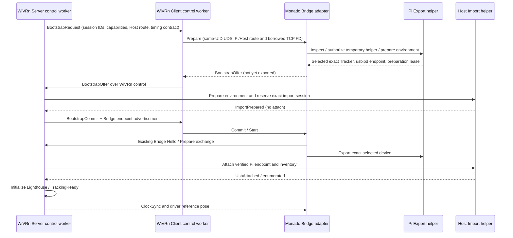

# WiVRn 接続連動の自動準備設計

2026-10-12、ユーザー要求。この文書は設計原本。
現在は Light-Bridge 側 SDK／helper を実装済み。実 APIと制限は
[AUTOMATIC-BOOTSTRAP.md](AUTOMATIC-BOOTSTRAP.md)、検証は [報告](AUTOMATIC-BOOTSTRAP-REPORT.md) を参照。
両 adapter の auto branch／WiVRn packet/UI は未統合。以下の候補名と実 API を区別する。
現在の d765f16 は exact JSON policy、手動 module／usbipd 準備、開発用一時 helper CLI を使用する。
本設計は通常利用の手動 IP／busid／sysfs／policy 入力を置き換える。
installer は引き続き後回し。一時 helper の自動準備経路を優先する。

## 目標と利用者の操作

Bridge をビルド・実行時に有効にして、普段の WiVRn 接続を開始する。
通常の LAN では IP、busid、sysfs path、時刻 domain ID、policy JSON を入力しない。
承認済み profile の Tracker が1台なら自動選択し、初回の必要な管理者承認を経て準備する。
複数候補では serial／製品名／接続位置を表示して選択。0台ではデバイス接続を案内する。
転送は WholeDevice、対象は1台。arpara HMD 2c30:1050 は常時拒否。
Helper 導入済み互換版は追加の権限要求なし。不一致は更新要求で開始中断。
未導入では一時利用を選択して管理者認証。installer の選択肢は未提供であることを明示する。
一時利用の新規起動ごとの管理者認証を省略するために、広い sudoers 許可は追加しない。
一時 helper は正常解放後も開発期間中再利用可能とし、毎接続の昇格を避ける。

## 現行ソースで確認した制約

- WiVRn b89ffb72、client/wivrn_client.cpp:280–322 は endpoint packet v1 の port／IDs と
  control socket の getpeername から Host IP を得ている。Host IP の手入力は元々不要。
- 同 server/driver/wivrn_connection.cpp:68–85 は getsockname／getpeername を使用する。
  server/target_instance_wivrn.cpp:70–123 は Import policy を手動で読み、listener を作り広告して wait_usb する。
  server/light_bridge_host.cpp:45 以降の preflight は固定 policy を前提とする。
- common/wivrn_packets.h:967 の endpoint packet v1 は port／host_id／correlation_id のみ。
  Pi の USB/IP endpoint／inventory／双方向 bootstrap packet はない。
- Monado 06dd3c29f、target_llfa_bridge.cpp:613 以降の environment factory は LLFA_BRIDGE_POLICY と
  timing IDs を必須にしている。create_handle(:65–88) と Start worker は固定 Export policy を使う。
  automatic mode では UDS listener と local arpara HEAD を policy 未決定でも先に生成する必要がある。
- Bridge d765f16 の helper RPC v2 は不変の Policy 全体を照合する。
  発見した IP を既存 root policy の remote に上書きするだけでは、この契約を満たさない。

上記は read-only source inspection。runtime の通信・暗号化設定や実機の自動準備成功を実証したものではない。

## 準備の順序と責務

bootstrap は既存 WiVRn control 接続の確立・認証状態の確認後、Lighthouse 初期化／映像準備の待機前に行う。
Server は最初の BootstrapRequest を helper policy／Tracker 決定前に送る。
Client は新しい bootstrap を映像開始前から処理し、Monado は helper 準備前から UDS を受け付ける。
Host の固定 policy preflight を移動し、Offer から確定した session policy を取得後に実施する。
この順序により「Host の広告待ち ↔ Pi の準備待ち」の循環を避ける。
Bridge 主動作核は Monado／WiVRn Server 内。WiVRn には USB driver／CLI を実装せず bootstrap metadata だけを渡す。
制御、選択、認証、package 準備、network I/O は専用 worker。pose query／HID／render thread を停止させない。

## アドレスの取得と交換

各側で接続済み WiVRn TCP の getsockname（local）／getpeername（peer）を取得する。
Server は観測した Client address、Client は観測した Server address と自分の local address を交換する。
packet から自己申告された任意 IP をそのまま USB attach の行先にしない。

- Host Bridge bind address は Server local。Client の Bridge 接続先は Client が観測した Server peer。
- Pi USB/IP bind/許可 interface は Client local。Host の import 行先は Server が観測した Client peer と
  Export helper が返した実 daemon port。Pi helper の許可相手は Client が観測した Server peer。
- IPv4-mapped IPv6 を正規化。IPv6 scope は各ホストの interface に依存するので peer の数値をコピーせず、
  それぞれの socket／route から自分の scope を解決する。NIC一覧の最初の IP や hostname 解決で推測しない。
- 同じ WiVRn peer の DHCP 変更は新しい session plan を生成。active 中の変更は停止・解放後の新 session とする。
- 初期対象は直接到達可能な同一検証 LAN。NAT／VPN／container／異なる network namespace 等で
  WiVRn の接続先と USB/IP の逆方向接続が一致しなければ、route 確認を行い未対応／到達不能を表示して中断する。
  独自 tunnel、port forwarding、第三者 IP への自動切替は初期実装に含めない。

root helper が実際の route を検査するため、runtime は接続済み TCP FD を SCM_RIGHTS で渡す契約にする。
Pi は Client → Monado UDS → Export helper の順で borrowed duplicate を渡す。
helper は socket type／connected 状態／local/peer／network namespace を検証し、アドレス検査にだけ使う。
WiVRn payload を読まない、shutdown しない、共有 FD flags を変えない。受信した duplicate のみ閉じる。
SO_PEERCRED と許可 UID を照合する。FD の受信数／種類／framing／期限を制限する。
FD は route の根拠であって WiVRn の暗号化認証の証明ではない。認証状態は許可された adapter が確認する。

自動準備の既定対象は WiVRn の認証が成立した接続。暗号化無効の開発接続は別の明示設定と閉域網を要する。
Bridge TCP は WiVRn control と別 socket のため、bootstrap の成功だけで認証済みとは扱わない。
少なくとも actual peer address と現在の connection/session IDs を照合し、既存のアクセス制限を維持する。

## Tracker 自動選択と policy 自動生成

root の許可 limits と、接続ごとの exact session policy を分離する。

`HelperAuthorization`（管理者が承認する範囲、フィールド名は設計上の候補）:

- role と permitted runtime UID/GID。
- 対応 Tracker profile／必要に応じて remembered serial。任意 USB class 全体は許可しない。
- 使用可能な network interface／port 範囲／開発 loopback 可否。
- module load、専用 usbipd 起動、専用 firewall rule 操作の許可範囲。
- package 準備は通常 RPC とは別の明示管理者承認操作。

`SessionUsbPlan`（runtime が自動生成し helper が実測で検証する exact plan）:

- session／correlation／instance、接続世代、WiVRn peer route。
- 単一 Tracker の VID/PID／serial と Pi 実 busid／canonical sysfs path／topology／interfaces。
- Pi USB/IP endpoint と helper 準備 lease ID。
- device/origin/frame/source/local clock IDs、timing limits。

Pi の SysfsInventory と supported-profile selector から候補を得る。
初期開発 profile は観測された 28de:2300 を対象とするが、製品名文字列や同じ vendor だけで許可しない。
helper は承認 limits 内の候補が1台ならその device を明示的な選択結果として確定し、exact policy を snapshot する。
「候補が1台」はユーザーの Bridge 有効化と管理者の auto-select profile 許可に基づく選択であり、全 USB 自動許可ではない。
複数なら serial と接続位置で利用者が選ぶ。以前選んだ serial があれば現在の inventory と照合して再選択する。
serial 重複／identity 不完全／未対応 profile／hub／vhci 経由／他 session 使用中は自動選択しない。
HMD の deny は GUI、selector、session plan、root engine の全段で優先する。

一時 helper の管理者承認前に候補／必要な system 変更を表示し、承認後に root inventory を再読して
同じ device か検証する。選択から bind までの抜き差しで別 device に切り替わったら中断する。
Host は Pi の Offer の exact identity を使う。Host の imported busid を policy の source busid にしない。
busid／sysfs／topology は接続ごとに再発見し、serial の保存と分離する。
root helper は許可範囲を検証し、確定した session policy を返す。runtime もこれと照合する。
RPC v2 の Policy equality を緩めたり、runtime が無制限に root policy を置換したりしない。

## USB/IP 初期準備の自動化

helper の非 mutation Inspect で prerequisites と残留資源を診断し、利用者向けに不足を分類する。
compatible helper 起動後は固定 typed 操作 PrepareEnvironment を USB 専用 worker が実行する。

1. CLI の root-owned 固定 path／実行可否、現在 kernel、module の利用可否、既存 state を確認。
2. Pi は usbip_host、Host は vhci_hcd を固定 argv の modprobe でロードする。
   既に使える場合は何もしない。kernel built-in は利用可能として扱い、modinfo の失敗だけで不在と判断しない。
3. Pi は専用の root-managed usbipd を一時 service として起動し、実際の listen port／process ownership を検証。
   default 3240。既存の他所有 daemon／port を kill しない。自分の互換 daemon だけ再利用する。
   port 変更は管理者の許可範囲内で実 listen 結果を返し、推測値を広告しない。
4. 標準 usbipd は remote 認証を持たないため、peer/interface/port に限定する専用 firewall 設定を準備する。
   対応 firewall backend のみ固定 typed 操作で自分の rule を作成。既存 rule の flush／firewall 無効化はしない。
   他 chain の drop を回避できると推測せず、Host → Pi の実到達試験を行う。
   管理済みの閉域網設定がある場合はその設定を検証して使う。制限を確保できなければ停止する。
5. daemon endpoint の到達試験と双方の Prepared を確認する。この時点では bind／attach しない。
6. BootstrapCommit 後に既存 export／attach／enumeration と Lighthouse 初期化へ進む。

不足パッケージは対応 OS profile の固定導入 plan を生成し、初回の管理者承認で自動導入できるようにする。
入力や remote packet から package 名／repository／shell command を受け取らない。
パッケージ導入は永続 system 変更なので一時 helper 自体の配備と区別して提示する。
未対応 distro／Ubuntu wrapper と Armbian kernel の不一致は推測で別 binary にリンクせず診断する。
kernel に USB/IP 機能が無い場合は「対応 kernel が必要」として中断。接続処理で kernel 交換／reboot／自動ビルドしない。
成功後の通常接続では導入処理を再実行せず、利用可否確認と必要な module／daemon 準備だけ行う。
package 準備は helper installer 実装とは別。installer の後回し方針を維持する。

一時 service／firewall rule／port と session の所有情報を USB journal と分離した environment lease に記録する。
既存 daemon／module は共有資源として区別。停止時に kernel module を自動 unload しない。
全 USB lease の解放確認後だけ、自分が起動した daemon／作成した rule を回収する。
不確定 USB 状態では daemon／helper を止めて回収完了と扱わず、両 journal を残す。

## 通信・状態・失敗契約

新しい WiVRn extension packet 候補:
BootstrapRequest、BootstrapOffer、BootstrapCommit、BootstrapAbort、BootstrapProgress。
各 packet に bootstrap schema version、connection generation、session/correlation、operation ID を付ける。
Request は route／capability／timing contract、Offer は exact inventory／verified endpoint／lease／Prepared、
Commit は双方 plan の一致、Abort は reason と cleanup 状態を含む。payload／候補数／queue／deadline を制限する。
候補選択・管理者認証の待機状態は通常の準備 timeout と分け、取消と有限のユーザー待機期限を設ける。
遅延した前接続 Offer／Commit と二重通知は reject または同一 operation の no-op。

UDS は Client ↔ Monado の双方向 bootstrap を追加する。現在の一方向 Start/Stop sender の拡張が必要。
既定 /tmp/llfa-llb.sock、WIVRN_LIGHT_BRIDGE_IPC、same UID／0600／既存 path 所有チェックは維持する。
既存 LLBI v1 の Start/Stop 構造体を黙って拡大しない。bootstrap 用の明示 versioned envelope と新 codec/C API を追加する。
helper は bootstrap／authorization／environment lease に対応する次版 RPC と専用 compatibility ID を発行する。
既存 ABI v1 layout は維持し、新しい size/version 付き config／result API を追加する。
WiVRn の新 packet は opt-in の新 extension hash／capability で交渉し、旧 hash/tag の挙動を維持する。
Bridge frame が変更不要なら TCP v3 を維持。変更する場合は新 wire version と両 adapter 更新を必須にする。
本設計の schema/version は実装時に確定する。現行 RPC v2／UDS v1 が bootstrap 対応済みとは扱わない。

setup state 候補:
Connected → Negotiating → AwaitingSelection/Authorization → PreparingEnvironment →
BothPrepared → Committed → existing Hello/Prepare/Attached/Ready → Releasing → Idle。
新 setup state を既存 session state 数値へ無条件追加せず、adapter bootstrap state として分離する。
準備失敗は両 runtime に通知し、既定は Bridge 開始の明示失敗。Mock／従来 tracking への無言切替は禁止。
手動 policy mode は明示選択した診断用 override として残すが、通常の auto mode で JSON 入力を要求しない。
Bridge OFF は既存経路のまま。opt-in の automatic mode では既存 policy env を必須にしない。

setup 完了前に USB mutation を行わない。bootstrap 失敗時は準備 lease だけを逆順に回収する。
USB mutation 後の失敗では既存 driver release → Host detach → Pi unexport が最優先。
normal disconnect 後の再接続は fresh WiVRn Server child／IDs。Monado は local IMU／listener を維持する。
timing IDs は Server が契約値を発行し両側へ配布する。Host/Pi の時計 epoch を同一とみなさず ClockSync を維持する。
姿勢の origin/frame と driver-reported timestamp／semantics／uncertainty の契約は変更しない。

## 実装の分担と完了条件

1. Bridge: selector／自動 plan／authorization と session policy 分離、FD 検証、environment preparation、
   daemon/firewall leases、次版 helper RPC、bootstrap UDS codec、FFI、Mock failure tests。
2. WiVRn: 接続 route の取得・交換、新 extension negotiation、映像待機前の bootstrap worker、
   Client ↔ Monado UDS、選択・管理者認証の UI/launcher、Host policy 決定後の preflight と listener。
3. Monado: policy-less auto listener、inventory/selection/bootstrap state、helper 準備と plan snapshot、
   Commit 後の configured handle／Start。arpara IMU・描画経路は維持。

auto mode の合格条件は、両端で IP／busid／policy JSON／timing ID の手入力なしに、
接続 → automatic selection →必要時の管理者承認 → module/daemon preparation → USB attach → Ready →
ClockSync/reference受信 → 正常解放まで成立すること。
0/複数候補、HMDのみ、serial重複、DHCP／複数NIC／IPv6 scope、既存不一致 helper、認証拒否、
不足 tools/modules、port競合、firewall拒否、daemon起動失敗、片側失敗、旧packet/replay、取消／切断を試験する。
失敗前後の mutation counts、lease／journal／daemon／rule と local IMU 継続を確認する。
native Mock、root systemd、実 USB/IP、Orange Pi ARM64 の結果を分ける。

Light-Bridge 側は SDK／helper が実装済み。実際の API／版／制限は利用契約を正とし、
両 runtime の自動接続統合と実機検証を後続作業として分けて報告する。
